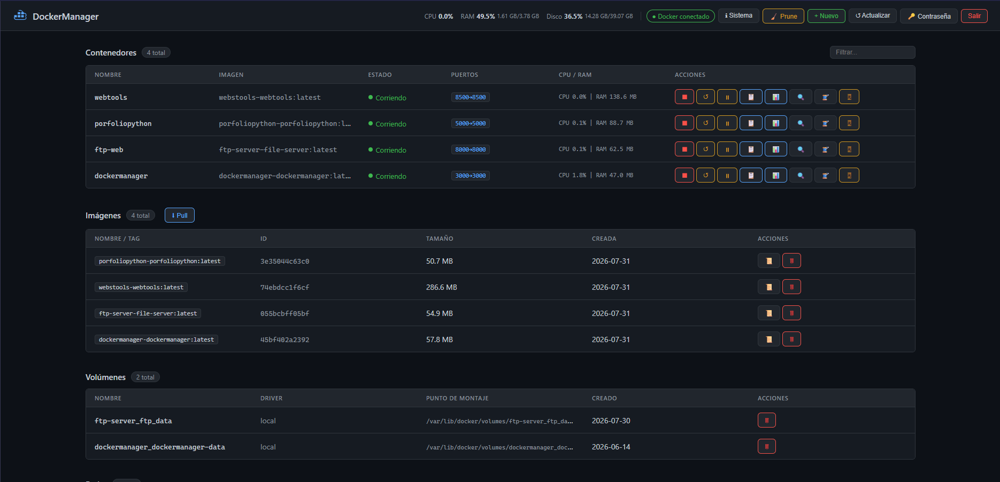

# DockerManager
---
> 🇬🇧 English | [🇪🇸 Español](docs/README.es.md)

A lightweight web interface for managing Docker from the browser. Built with FastAPI and vanilla JavaScript — no frontend frameworks, no external runtime dependencies.

  



## ✨ Features ✨
---

### Containers
- List all containers with name, image, status, ports, and live CPU/RAM stats
- Containers grouped by Docker Compose stack, or by name prefix when there is none (`App`, `App-db`, `App-caddy` share a group), with collapsible groups and one-click start/restart/stop for a whole group
- Start, stop, restart, pause, and resume containers
- Healthcheck status and status filter
- Create containers via UI: image, name, command, restart policy, ports, environment variables, volumes, and network
- Real-time log streaming with autoscroll, clear, and download as `.log`
- Interactive terminal (xterm.js) with automatic `bash`/`sh` detection and dynamic resize
- Live stats modal: CPU%, RAM%, network I/O, and a 60-point rolling chart (Chart.js)
- Inspect modal: network interfaces, mounts, environment, restart policy, resource limits
- Process list (`docker top`) with refresh
- Browser notifications when a container transitions out of `running`

### Images
- List images with tag, ID, size, and creation date
- Images and volumes classified by owner (stack or container), with a "Sin usar" (unused) group
- Pull images by tag
- Delete images
- View layer history

### Volumes & Networks
- Overview cards: running containers, stacks, images, volumes, networks
- List, inspect, and delete volumes and networks
- Connect and disconnect containers from networks via the inspect modal

### System
- Host stats bar (CPU%, RAM, disk and CPU temperature when available) updated every 4 seconds via `psutil`
- **Server** window: live host status refreshed every 3 seconds while open: CPU (total, per core, frequency, load average), RAM and swap, disk usage and read/write speed, temperatures and fans, uptime, plus a CPU / RAM / temperature history chart. Values turn amber or red past their thresholds
- Docker daemon info: version, OS, kernel, architecture, storage driver
- One-click prune: stopped containers, dangling images, unused volumes, orphaned networks
- **Clean up** window: lists images and volumes not used by any container (not even a stopped one) and older than N days (default 30), lets you pick images, volumes or both, and deletes only those

### Security
- Session cookie: `HttpOnly`, `SameSite=Strict`; the session expires server-side and survives container restarts (only its HMAC is stored in the data volume); logout and password changes invalidate it
- Password hashing: bcrypt (cost 12)
- Brute-force protection: 5 failed attempts → 15-minute IP lockout. `X-Forwarded-For` is ignored unless the connection comes from a proxy listed in `trusted_proxies`
- Login runs bcrypt even for unknown usernames, so response time does not reveal valid users
- WebSockets (logs, stats, terminal) reject handshakes whose `Origin` does not match the host
- CDN scripts and styles pinned with Subresource Integrity (`integrity`)
- Container runs as a non-root user with a read-only filesystem, `cap_drop: ALL` and `no-new-privileges`
- XSS mitigation: all dynamic content escaped; CSP headers
- Anti-clickjacking: `X-Frame-Options: DENY`
- MIME sniffing prevention: `X-Content-Type-Options: nosniff`
- Timing-safe credential comparison via `secrets.compare_digest()`

### Telegram notifications (optional)
- Alerts about crashed containers (non-zero exit code), OOM kills, `unhealthy` healthchecks and restart loops
- Security alerts: successful login (with IP), IP lockout, password change and initial setup
- New version published and update result (ok / failed with the script output)
- Critical CPU temperature and disk almost full, with a recovery notice
- Read-only commands: `/estado`, `/contenedores`, `/ayuda`
- Only the user IDs in `TELEGRAM_IDS_PERMITIDOS` receive alerts or get answers, and only in a private chat. Messages from anyone else are dropped without reading their text or replying
- Long polling, no webhook: no extra port is exposed

### PWA
Installable as a desktop or mobile app via Chrome, Edge, or Safari.

## 🖥️ Requirements
---

- **Docker Engine** with the Compose plugin (`docker compose`) — the recommended path
- Access to the Docker socket (`/var/run/docker.sock`)
- A POSIX shell (`sh`), plus `awk` and `openssl` (or `/dev/urandom`) for `docker-up.sh`
- A free TCP port on the host (default `3000`)

Only if you install natively instead of with Docker (`install.sh`, Ubuntu + systemd):

- Python 3.12 with `python3-venv`
- The current user in the `docker` group

**Stack**

| Layer | Technology |
|---|---|
| Backend | Python 3.12, FastAPI, Uvicorn |
| Docker SDK | `docker` 7.1 |
| Host stats | `psutil` 6.1 |
| Auth | `bcrypt` (cost 12) |
| Real-time | WebSocket (logs, stats, terminal) |
| Terminal | xterm.js 5.3 + FitAddon |
| Charts | Chart.js 4.4 |
| Frontend | HTML + CSS + Vanilla JS |
| Deploy | Docker Compose |

## 📦 Installation guide ⚙️
---

### With Docker (recommended)

```bash
git clone https://github.com/FranciscoFdez05/DockerManager.git
cd DockerManager
./docker-up.sh
```

`docker-up.sh` creates the `.env` with a freshly generated `SECRET_KEY`, reads the listening port from `[server] port` in `config.ini`, and brings the stack up published on all interfaces. It prints the LAN URL when it finishes.

It also writes `DM_UID`, `DM_GID` (your user) and `DOCKER_GID` (group owning `/var/run/docker.sock`) to the `.env`: the container runs as that user, not as root, and a one-shot `dockermanager-permisos` service hands the data volume over to it before the app starts. Keep in mind that access to the Docker socket is still equivalent to root on the host.

### Native install (Ubuntu + systemd)

```bash
bash install.sh
```

Installs the app in `/opt/dockergestor` with its own virtualenv and registers the `dockergestor` systemd service.

### Configuration

Everything is set in `config.ini`. Environment variables (`DATA_DIR`, `PORT`, `HOST`, `DOCKER_HOST`) take priority over the file.

| Section | Key | Default | Description |
|---|---|---|---|
| `server` | `port` | `3000` | Listening port |
| `server` | `bind_host` | `0.0.0.0` | Bind address |
| `docker` | `data_dir` | `./data` | Where `config.json` (user + password hash) is stored |
| `docker` | `docker_socket` | `/var/run/docker.sock` | Docker Unix socket |
| `security` | `session_max_age_days` | `30` | Session lifetime |
| `security` | `bcrypt_cost` | `12` | bcrypt hashing cost |
| `security` | `max_login_attempts` | `5` | Failed logins before lockout |
| `security` | `lockout_minutes` | `15` | Lockout duration |
| `security` | `trusted_proxies` | empty | Comma-separated IPs/CIDRs of reverse proxies whose `X-Forwarded-For` is trusted |
| `servidor` | `temperatura_aviso` | `70` | Warning temperature (°C) when the sensor does not publish its own |
| `servidor` | `temperatura_critica` | `85` | Critical temperature (°C) when the sensor does not publish its own |
| `servidor` | `ruta_disco` | `/` | Path whose filesystem the Server window measures |
| `telegram` | `notificar` | all | Alert categories: `sistema`, `contenedores`, `seguridad`, `actualizaciones`, `recursos` |
| `telegram` | `timeout_segundos` | `10` | Timeout of each Telegram API request |
| `telegram` | `intervalo_segundos` | `60` | How often resources and updates are checked |
| `telegram` | `disco_aviso_pct` | `90` | Disk usage (%) that triggers an alert |
| `telegram` | `reinicios_bucle` | `3` | Crashes of one container that count as a restart loop... |
| `telegram` | `ventana_bucle_minutos` | `10` | ...within this many minutes |

#### Telegram

The bot token and the authorized user IDs are **only** read from environment variables (the `.env` file), never from `config.ini`, which is public in the repository. If either one is missing or invalid, Telegram stays disabled.

| Variable | Description |
|---|---|
| `TELEGRAM_BOT_TOKEN` | Bot token from [@BotFather](https://t.me/BotFather) (`/newbot`) |
| `TELEGRAM_IDS_PERMITIDOS` | Comma-separated user IDs allowed to receive alerts and send commands. Get yours from [@userinfobot](https://t.me/userinfobot). Group IDs (negative) are rejected |

1. Create the bot with @BotFather and copy the token.
2. Add both variables to `.env` and restart: `./docker-up.sh`.
3. Open a private chat with your bot and press **Start**. Telegram does not let a bot write to you first.
4. Restart DockerManager and use **Settings → Alerts → Send test** to check that messages arrive.

For a native install, add both variables to the service with `sudo systemctl edit dockergestor` (`[Service]` → `Environment=TELEGRAM_BOT_TOKEN=...`).

What has already been notified (published version, last update result) is stored in `telegram.json` in the data directory, so a restart does not repeat it.

### Updating

```bash
./docker-update.sh
```

**From the web UI** — click the version badge in the header (`v1.1.0`) to open the update
dropdown: installed vs. latest published version (read from `version.py` on the GitHub
branch), **Check versions** and **Update now**. A dot appears on the badge when a new version
is out. **Update now** opens a confirmation window with both versions and the release notes of
every version in between, read from `CHANGELOG.md` on the same branch. The app cannot rebuild its own container without killing itself mid-update, so the
button only leaves a request; a small **watcher** on the host (a systemd timer that checks
every 30 s) picks it up and runs `docker-update.sh`. Install it once:

```bash
sudo ./tools/actualizador/instalar-vigilante.sh
```

Or manually:

```bash
docker compose down
./docker-up.sh
```

## 📋 Usage guide 🕹️
---

Open `http://<host-ip>:<port>` from any device on the same network (default port `3000`, change it in `config.ini` and re-run the script). On first launch, you will be prompted to create an admin account. Credentials are stored persistently in a Docker volume (`dockermanager-data`).

From there:

- **Containers** — the main table. Buttons per row for start/stop/restart/pause; click a container to open logs, terminal, stats, or inspect.
- **Images / Volumes / Networks** — tabs to list, pull, inspect, and delete.
- **System** — host and daemon info, plus the prune button.
- **Server** — host status: CPU, memory, disk, temperatures and history chart. Running in the container, CPU, load, memory, disk I/O and temperatures are the host's (`/proc` and `/sys` are not isolated per container). Host network traffic and processes are not shown: in bridge mode the container only sees its own. Temperatures need a hardware sensor exposed in `/sys/class/hwmon`; virtual machines usually have none.
- **Clean up** — header button that previews old unused images/volumes before deleting them. The default age is `[limpieza] dias_por_defecto` in `config.ini`.
- **Settings** — gear button in the header. Read-only view of the configuration in force (`config.ini` and `.env`), grouped into *Account and security*, *Alerts*, *Updates* and *Server and cleanup*, plus the related actions: change password, Telegram test message, check/run update and open the clean-up window. Values are still changed in `config.ini` / `.env` and applied on restart. The Telegram token is never sent to the browser, not even masked.

If another machine on the LAN cannot connect, open the port in the server's firewall.

### Project structure

```
DockerManager/
├── main.py              # FastAPI app: REST API, WebSockets, auth
├── config.py            # config.ini + env var loader
├── config.ini           # Editable configuration
├── requirements.txt
├── Dockerfile
├── docker-compose.yml
├── docker-up.sh         # Startup script (.env + port + compose up)
├── install.sh           # Native installer (Ubuntu + systemd)
├── docker-update.sh    # Update + health check + auto-rollback
├── actualizacion.py     # Version check + update request for the host watcher
├── limpieza.py          # Selective cleanup of old unused images and volumes
├── telegrama.py         # Telegram Bot API client, allow-list, alert queue
├── avisos.py            # What gets notified and when; read-only bot commands
├── servidor.py          # Host metrics: CPU, memory, disk, temperatures
├── ajustes.py           # Read-only configuration summary for the Settings screen
├── seguridad.py         # Session, login rate limiting, client IP, WebSocket Origin check
├── clienteDocker.py     # Shared Docker client
├── tests/               # pytest suite
├── tools/actualizador/  # Host watcher (systemd timer) that runs docker-update.sh
├── docs/
│   └── README.es.md     # Spanish documentation
└── static/
    ├── index.html
    ├── style.css
    ├── app.js
    ├── favicon.svg
    └── manifest.json
```

### API reference

#### Auth

| Method | Route | Description |
|---|---|---|
| `GET` | `/api/auth/status` | Auth status (`setup_needed`, `authenticated`) |
| `POST` | `/api/auth/setup` | Initial account creation |
| `POST` | `/api/auth/login` | Login (rate-limited: 5 attempts / 15 min) |
| `POST` | `/api/auth/logout` | Logout |
| `POST` | `/api/auth/change-password` | Change password |

#### Containers

| Method | Route | Description |
|---|---|---|
| `GET` | `/api/containers` | List all |
| `POST` | `/api/containers/create` | Create |
| `POST` | `/api/containers/{id}/start` | Start |
| `POST` | `/api/containers/{id}/stop` | Stop |
| `POST` | `/api/containers/{id}/restart` | Restart |
| `POST` | `/api/containers/{id}/pause` | Pause |
| `POST` | `/api/containers/{id}/unpause` | Unpause |
| `DELETE` | `/api/containers/{id}` | Remove |
| `GET` | `/api/containers/{id}/inspect` | Full inspect |
| `GET` | `/api/containers/{id}/processes` | Process list (top) |
| `GET` | `/api/containers/{id}/stats_once` | Snapshot stats |
| `GET` | `/api/containers/{id}/logs/download` | Download logs |
| `POST` | `/api/containers/{id}/networks/connect` | Connect to network |
| `POST` | `/api/containers/{id}/networks/disconnect` | Disconnect from network |

#### Images

| Method | Route | Description |
|---|---|---|
| `GET` | `/api/images` | List |
| `DELETE` | `/api/images/{id}` | Remove |
| `POST` | `/api/images/pull` | Pull by tag |
| `GET` | `/api/images/{id}/history` | Layer history |

#### Volumes, Networks & System

| Method | Route | Description |
|---|---|---|
| `GET` | `/api/volumes` | List volumes |
| `DELETE` | `/api/volumes/{name}` | Remove volume |
| `GET` | `/api/networks` | List networks |
| `DELETE` | `/api/networks/{id}` | Remove network |
| `GET` | `/api/system/info` | Docker + host info |
| `GET` | `/api/system/host` | CPU / RAM / disk / CPU temperature |
| `GET` | `/api/system/metrics` | Detailed host metrics: CPU per core, load, memory, swap, disk I/O, temperatures, fans, uptime |
| `POST` | `/api/system/prune` | System prune |
| `GET` | `/api/limpieza` | Preview old unused images/volumes (`?dias=N`, default from `config.ini`) |
| `POST` | `/api/limpieza` | Delete them: `{"dias": 30, "tipos": ["imagenes", "volumenes"]}` |
| `GET` | `/api/actualizacion` | Installed / published version and update status (`?refrescar=1` skips the cache) |
| `POST` | `/api/actualizacion` | Request an update from the host watcher |

#### WebSockets

| Route | Description |
|---|---|
| `WS /ws/containers/{id}/logs` | Real-time log stream |
| `WS /ws/containers/{id}/stats` | CPU / RAM / network stats (~1 s interval) |
| `WS /ws/containers/{id}/exec` | Interactive shell |

## 🤝 Contributions 🤝
---

Contributions are welcome. To propose a change:

1. Fork the repository and create a branch (`git checkout -b feature/my-feature`).
2. Make your changes, keeping the existing style (vanilla JS, no new runtime dependencies).
3. Test with `./docker-up.sh` before opening the PR.
4. Commit (`git commit -m "Add my feature"`), push, and open a Pull Request describing the change.

For bugs or ideas, open an [issue](https://github.com/FranciscoFdez05/DockerManager/issues).

## 📜 License
---
📄 This project is licensed under the MIT License. See the `LICENSE` file for details.

---

**Developed with ❤️ by [Francisco](https://github.com/FranciscoFdez05)**
