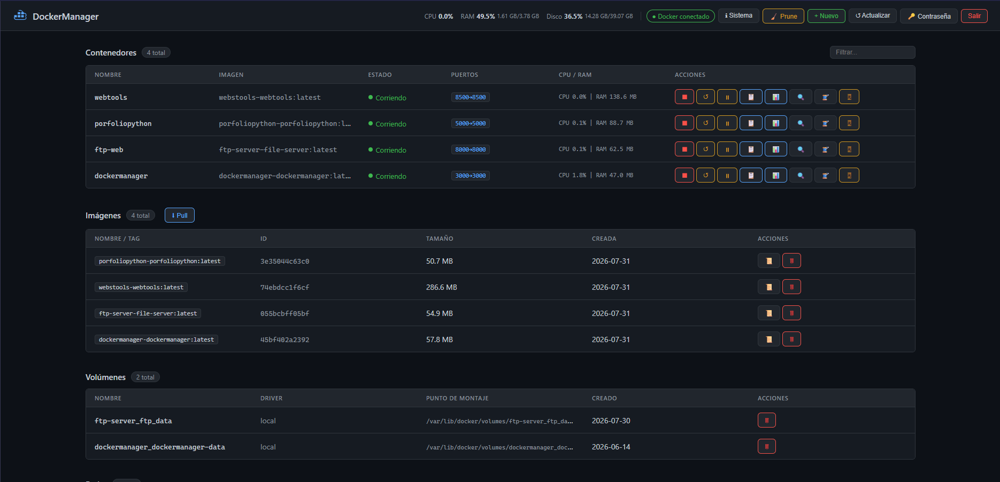

[🇪🇸 Español](README.es.md) | [🇬🇧 English](../README.md)

<p align="center">
  
</p>

<h1 align="center">DockerManager</h1>

<p align="center">
  <a href="../CHANGELOG.md"></a>
  
  
  
  <a href="../LICENSE"></a>
</p>

---

Interfaz web **autoalojada** para gestionar Docker desde el navegador. Construida con FastAPI y JavaScript puro — sin frameworks de frontend, sin dependencias de runtime externas.



## ✨ Características ✨
---

### Contenedores
- Lista todos los contenedores con nombre, imagen, estado, puertos y estadísticas en vivo de CPU/RAM
- Contenedores agrupados por stack de Docker Compose o, si no hay, por el prefijo del nombre (`App`, `App-db`, `App-caddy` comparten grupo), con grupos plegables e inicio/reinicio/parada de un grupo completo
- Iniciar, detener, reiniciar, pausar y reanudar contenedores
- Estado del healthcheck y filtro por estado
- Crear contenedores desde la UI: imagen, nombre, comando, política de reinicio, puertos, variables de entorno, volúmenes y red
- Streaming de logs en tiempo real con desplazamiento automático, limpiar y descargar como `.log`
- Terminal interactiva (xterm.js) con detección automática de `bash`/`sh` y redimensionado dinámico
- Modal de estadísticas en vivo: CPU%, RAM%, I/O de red y gráfico deslizante de 60 puntos (Chart.js)
- Modal de inspección: interfaces de red, montajes, entorno, política de reinicio y límites de recursos
- Lista de procesos (`docker top`) con actualización manual
- Notificaciones del navegador cuando un contenedor sale del estado `running`

### Imágenes
- Lista imágenes con etiqueta, ID, tamaño y fecha de creación
- Imágenes y volúmenes clasificados por propietario (stack o contenedor), con un grupo «Sin usar»
- Descargar imágenes por etiqueta
- Eliminar imágenes
- Ver historial de capas

### Volúmenes y Redes
- Listar, inspeccionar y eliminar volúmenes y redes
- Conectar y desconectar contenedores de redes desde el modal de inspección

### Sistema
- Barra de estadísticas del host (CPU%, RAM, disco y temperatura de CPU si la hay) actualizada cada 4 segundos vía `psutil`
- Ventana **Servidor**: estado del host en vivo, refrescado cada 3 segundos mientras está abierta: CPU (total, por núcleo, frecuencia, carga media), RAM y swap, uso de disco y velocidad de lectura/escritura, temperaturas y ventiladores, tiempo encendido y gráfica histórica de CPU / RAM / temperatura. Los valores se ponen en ámbar o rojo al pasar sus umbrales
- Información del demonio Docker: versión, SO, kernel, arquitectura y driver de almacenamiento
- Limpieza con un clic: contenedores detenidos, imágenes huérfanas, volúmenes sin uso y redes orphan
- Ventana **Limpiar**: lista las imágenes y volúmenes que no usa ningún contenedor (ni siquiera uno parado) y tienen más de N días (30 por defecto), permite elegir imágenes, volúmenes o ambos y borra solo esos

### Seguridad
- Cookie de sesión: `HttpOnly`, `SameSite=Strict`; la sesión caduca en el servidor y sobrevive a los reinicios del contenedor (en el volumen de datos solo se guarda su HMAC); el logout y el cambio de contraseña la invalidan
- Hash de contraseñas: bcrypt (coste 12)
- Protección contra fuerza bruta: 5 intentos fallidos → bloqueo de IP por 15 minutos. `X-Forwarded-For` se ignora salvo que la conexión venga de un proxy de `trusted_proxies`
- El login ejecuta bcrypt aunque el usuario no exista: el tiempo de respuesta no revela usuarios válidos
- Los WebSockets (logs, stats, terminal) rechazan el handshake si `Origin` no coincide con el host
- Scripts y estilos del CDN fijados con Subresource Integrity (`integrity`)
- El contenedor corre sin root, con sistema de archivos de solo lectura, `cap_drop: ALL` y `no-new-privileges`
- Mitigación de XSS: todo el contenido dinámico escapado; cabeceras CSP
- Anti-clickjacking: `X-Frame-Options: DENY`
- Prevención de sniffing MIME: `X-Content-Type-Options: nosniff`
- Comparación de credenciales en tiempo constante con `secrets.compare_digest()`

### Avisos por Telegram (opcional)
- Contenedores caídos (código de salida distinto de 0), muertes por falta de memoria (OOM), healthchecks `unhealthy` y bucles de reinicios
- Seguridad: login correcto (con IP), IP bloqueada, cambio de contraseña y configuración inicial
- Versión nueva publicada y resultado de la actualización (correcta o fallida, con la salida del script)
- Temperatura de CPU crítica y disco casi lleno, con aviso de recuperación
- Comandos de solo lectura: `/estado`, `/contenedores`, `/ayuda`
- Solo los IDs de `TELEGRAM_IDS_PERMITIDOS` reciben avisos y obtienen respuesta, y solo por chat privado. Los mensajes de cualquier otro se descartan sin leer su texto ni contestar
- Long-polling, sin webhook: no se expone ningún puerto adicional

### PWA
Instalable como aplicación de escritorio o móvil desde Chrome, Edge o Safari.

## 🖥️ Requisitos
---

- **Docker Engine** con el plugin Compose (`docker compose`) — la vía recomendada
- Acceso al socket de Docker (`/var/run/docker.sock`)
- Un shell POSIX (`sh`), además de `awk` y `openssl` (o `/dev/urandom`) para `docker-up.sh`
- Un puerto TCP libre en el host (por defecto `3000`)

Solo si instalas de forma nativa en vez de con Docker (`install.sh`, Ubuntu + systemd):

- Python 3.12 con `python3-venv`
- El usuario actual en el grupo `docker`

**Stack**

| Capa | Tecnología |
|---|---|
| Backend | Python 3.12, FastAPI, Uvicorn |
| Docker SDK | `docker` 7.1 |
| Estadísticas del host | `psutil` 6.1 |
| Autenticación | `bcrypt` (coste 12) |
| Tiempo real | WebSocket (logs, stats, terminal) |
| Terminal | xterm.js 5.3 + FitAddon |
| Gráficas | Chart.js 4.4 |
| Frontend | HTML + CSS + Vanilla JS |
| Despliegue | Docker Compose |

## 📦 Guía de instalación ⚙️
---

### Con Docker (recomendado)

```bash
git clone https://github.com/FranciscoFdez05/DockerManager.git
cd DockerManager
./docker-up.sh
```

`docker-up.sh` crea el `.env` con una `SECRET_KEY` recién generada, lee el puerto de escucha de `[server] port` en `config.ini` y levanta el stack publicado en todas las interfaces. Al terminar imprime la URL de la LAN.

También escribe en el `.env` `DM_UID`, `DM_GID` (tu usuario) y `DOCKER_GID` (grupo dueño de `/var/run/docker.sock`): el contenedor corre con ese usuario, no como root, y un servicio de un solo uso, `dockermanager-permisos`, le cede el volumen de datos antes de arrancar la app. Ten en cuenta que el acceso al socket de Docker sigue equivaliendo a root en el host.

### Instalación nativa (Ubuntu + systemd)

```bash
bash install.sh
```

Instala la app en `/opt/dockergestor` con su propio entorno virtual y registra el servicio systemd `dockergestor`.

### Configuración

Todo se ajusta en `config.ini`. Las variables de entorno (`DATA_DIR`, `PORT`, `HOST`, `DOCKER_HOST`) tienen prioridad sobre el archivo.

| Sección | Clave | Por defecto | Descripción |
|---|---|---|---|
| `server` | `port` | `3000` | Puerto de escucha |
| `server` | `bind_host` | `0.0.0.0` | Dirección de bind |
| `docker` | `data_dir` | `./data` | Dónde se guarda `config.json` (usuario + hash de contraseña) |
| `docker` | `docker_socket` | `/var/run/docker.sock` | Socket Unix de Docker |
| `security` | `session_max_age_days` | `30` | Duración de la sesión |
| `security` | `bcrypt_cost` | `12` | Coste del hash bcrypt |
| `security` | `max_login_attempts` | `5` | Intentos fallidos antes del bloqueo |
| `security` | `lockout_minutes` | `15` | Duración del bloqueo |
| `security` | `trusted_proxies` | vacío | IPs/redes CIDR de proxies inversos, separadas por comas, de los que se acepta `X-Forwarded-For` |
| `servidor` | `temperatura_aviso` | `70` | Temperatura de aviso (ºC) si el sensor no publica la suya |
| `servidor` | `temperatura_critica` | `85` | Temperatura crítica (ºC) si el sensor no publica la suya |
| `servidor` | `ruta_disco` | `/` | Ruta cuyo sistema de ficheros mide la ventana Servidor |
| `telegram` | `notificar` | todas | Categorías de aviso: `sistema`, `contenedores`, `seguridad`, `actualizaciones`, `recursos` |
| `telegram` | `timeout_segundos` | `10` | Timeout de cada petición a la API de Telegram |
| `telegram` | `intervalo_segundos` | `60` | Cada cuánto se comprueban recursos y actualizaciones |
| `telegram` | `disco_aviso_pct` | `90` | Uso de disco (%) a partir del que se avisa |
| `telegram` | `reinicios_bucle` | `3` | Caídas de un contenedor que cuentan como bucle de reinicios... |
| `telegram` | `ventana_bucle_minutos` | `10` | ...dentro de estos minutos |

#### Telegram

Telegram se configura desde **Ajustes › Avisos** en la web y se aplica sin reiniciar:

1. Crea el bot con [@BotFather](https://t.me/BotFather) (`/newbot`) y pega el token. Se comprueba con Telegram (`getMe`) antes de guardarlo y nunca se devuelve al navegador.
2. Añade los IDs de usuario que reciben avisos y pueden usar comandos, separados por comas. El tuyo te lo da [@userinfobot](https://t.me/userinfobot). Los IDs de grupo (negativos) se rechazan.
3. Abre un chat privado con tu bot y pulsa **Iniciar**. Telegram no deja que un bot te escriba primero.
4. Usa **Enviar prueba** para comprobar que los mensajes llegan.

Las categorías y los umbrales se cambian en la misma pantalla. Lo guardado desde la web va a `telegram-config.json`, dentro del directorio de datos y con permisos `0600`, y tiene prioridad sobre `[telegram]` de `config.ini`. **Borrar configuración guardada** elimina ese fichero.

Si cambian el token o los IDs, los IDs que estaban autorizados reciben un aviso con la IP desde la que se hizo el cambio.

Prioridad: variables de entorno > web > `config.ini`. El token y los IDs también se pueden definir en el `.env`. En ese caso **mandan sobre la web**, y la interfaz los muestra bloqueados:

| Variable | Descripción |
|---|---|
| `TELEGRAM_BOT_TOKEN` | Token del bot |
| `TELEGRAM_IDS_PERMITIDOS` | IDs de usuario autorizados, separados por comas |

En la instalación nativa, defínelas con `sudo systemctl edit dockergestor` (`[Service]` → `Environment=TELEGRAM_BOT_TOKEN=...`).

Lo ya avisado (versión publicada, último resultado de actualización) se guarda en `telegram.json` dentro del directorio de datos, para no repetirlo tras un reinicio.

### Actualización

```bash
./docker-update.sh
```

**Desde la web** — pulsa la versión de la cabecera (`v1.2.0`) y se abre el desplegable de
actualización: versión instalada y última publicada (leída del `version.py` de la rama en
GitHub), **Comprobar versiones** y **Actualizar ahora**. Si hay versión nueva, la versión lleva
un punto ámbar. **Actualizar ahora** abre una ventana de confirmación con las dos versiones y las
novedades de cada versión intermedia, leídas del `CHANGELOG.md` de la misma rama. Los dos se
leen del último commit de la rama, que se consulta a la API de GitHub, así que **Comprobar versiones**
ve una versión nueva en cuanto se publica y no hasta 5 minutos después (caché del CDN de GitHub).
Si la API no responde, se leen de la rama. La app no puede reconstruir su propio contenedor sin matarse a mitad, así que el
botón solo deja una petición; la recoge un **vigilante** en el host (un temporizador de systemd
que mira cada 30 s) y ejecuta `docker-update.sh`. Se instala una vez:

```bash
sudo ./tools/actualizador/instalar-vigilante.sh
```

O manualmente:

```bash
docker compose down
./docker-up.sh
```

## 📋 Guía de uso 🕹️
---

Abre `http://<ip-del-host>:<puerto>` desde cualquier dispositivo de la misma red (puerto `3000` por defecto; cámbialo en `config.ini` y vuelve a ejecutar el script). En el primer inicio se te pedirá crear una cuenta de administrador. Las credenciales se almacenan de forma persistente en un volumen Docker (`dockermanager-data`).

A partir de ahí:

- **Contenedores** — la tabla principal. Botones por fila para iniciar/detener/reiniciar/pausar; haz clic en un contenedor para abrir logs, terminal, estadísticas o inspección.
- **Imágenes / Volúmenes / Redes** — pestañas para listar, descargar, inspeccionar y eliminar.
- **Sistema** — información del host y del demonio, además del botón de limpieza.
- **Servidor** — estado del host: CPU, memoria, disco, temperaturas y gráfica histórica. Dentro del contenedor, CPU, carga, memoria, E/S de disco y temperaturas son las del host (`/proc` y `/sys` no se aíslan por contenedor). No se muestran el tráfico de red ni los procesos del host: en modo bridge el contenedor solo ve los suyos. Las temperaturas necesitan un sensor expuesto en `/sys/class/hwmon`; las máquinas virtuales no suelen tenerlo.
- **Limpiar** — botón de la cabecera que muestra las imágenes y volúmenes viejos sin usar antes de borrarlos. La antigüedad por defecto es `[limpieza] dias_por_defecto` en `config.ini`.
- **Ajustes** — botón del engranaje en la cabecera. Vista de solo lectura de la configuración en vigor (`config.ini` y `.env`), agrupada en *Cuenta y seguridad*, *Avisos*, *Actualizaciones* y *Servidor y limpieza*, con las acciones relacionadas: cambiar la contraseña, mensaje de prueba de Telegram, comprobar/lanzar la actualización y abrir la ventana de limpieza. Los valores se siguen cambiando en `config.ini` / `.env` y se aplican al reiniciar. El token de Telegram nunca llega al navegador, ni enmascarado.

Si otro equipo de la red no conecta, abre el puerto en el firewall del servidor.

### Estructura del proyecto

```
DockerManager/
├── main.py              # App FastAPI: REST API, WebSockets, autenticación
├── config.py            # Carga de config.ini + variables de entorno
├── config.ini           # Configuración editable
├── requirements.txt
├── Dockerfile
├── docker-compose.yml
├── docker-up.sh         # Script de arranque (.env + puerto + compose up)
├── install.sh           # Instalador nativo (Ubuntu + systemd)
├── docker-update.sh    # Actualiza, comprueba y vuelve atrás si falla
├── actualizacion.py     # Comprobación de versión y petición al vigilante
├── limpieza.py          # Limpieza selectiva de imágenes y volúmenes viejos sin usar
├── telegrama.py         # Cliente de la Bot API, lista blanca y cola de avisos
├── avisos.py            # Qué se avisa y cuándo; comandos de solo lectura del bot
├── configTelegram.py    # Configuración de Telegram editable desde la web (.env > web > config.ini)
├── servidor.py          # Métricas del host: CPU, memoria, disco, temperaturas
├── ajustes.py           # Resumen de solo lectura de la configuración para «Ajustes»
├── seguridad.py         # Sesión, límite de intentos, IP del cliente, Origin de los WebSocket
├── clienteDocker.py     # Cliente de Docker compartido
├── tests/               # Tests con pytest
├── tools/actualizador/  # Vigilante del host (timer de systemd) que lanza docker-update.sh
├── docs/
│   └── README.es.md     # Documentación en español
└── static/
    ├── index.html
    ├── style.css
    ├── app.js
    ├── favicon.svg
    └── manifest.json
```

### Referencia de la API

#### Autenticación

| Método | Ruta | Descripción |
|---|---|---|
| `GET` | `/api/auth/status` | Estado de auth (`setup_needed`, `authenticated`) |
| `POST` | `/api/auth/setup` | Creación de cuenta inicial |
| `POST` | `/api/auth/login` | Login (limitado: 5 intentos / 15 min) |
| `POST` | `/api/auth/logout` | Logout |
| `POST` | `/api/auth/change-password` | Cambiar contraseña |

#### Contenedores

| Método | Ruta | Descripción |
|---|---|---|
| `GET` | `/api/containers` | Listar todos |
| `POST` | `/api/containers/create` | Crear |
| `POST` | `/api/containers/{id}/start` | Iniciar |
| `POST` | `/api/containers/{id}/stop` | Detener |
| `POST` | `/api/containers/{id}/restart` | Reiniciar |
| `POST` | `/api/containers/{id}/pause` | Pausar |
| `POST` | `/api/containers/{id}/unpause` | Reanudar |
| `DELETE` | `/api/containers/{id}` | Eliminar |
| `GET` | `/api/containers/{id}/inspect` | Inspección completa |
| `GET` | `/api/containers/{id}/processes` | Lista de procesos (top) |
| `GET` | `/api/containers/{id}/stats_once` | Estadísticas puntuales |
| `GET` | `/api/containers/{id}/logs/download` | Descargar logs |
| `POST` | `/api/containers/{id}/networks/connect` | Conectar a red |
| `POST` | `/api/containers/{id}/networks/disconnect` | Desconectar de red |

#### Imágenes

| Método | Ruta | Descripción |
|---|---|---|
| `GET` | `/api/images` | Listar |
| `DELETE` | `/api/images/{id}` | Eliminar |
| `POST` | `/api/images/pull` | Descargar por etiqueta |
| `GET` | `/api/images/{id}/history` | Historial de capas |

#### Volúmenes, Redes y Sistema

| Método | Ruta | Descripción |
|---|---|---|
| `GET` | `/api/volumes` | Listar volúmenes |
| `DELETE` | `/api/volumes/{name}` | Eliminar volumen |
| `GET` | `/api/networks` | Listar redes |
| `DELETE` | `/api/networks/{id}` | Eliminar red |
| `GET` | `/api/system/info` | Info Docker + host |
| `GET` | `/api/system/host` | CPU / RAM / disco / temperatura de CPU |
| `GET` | `/api/system/metrics` | Métricas detalladas del host: CPU por núcleo, carga, memoria, swap, E/S de disco, temperaturas, ventiladores, tiempo encendido |
| `POST` | `/api/system/prune` | Limpieza del sistema |
| `GET` | `/api/limpieza` | Vista previa de imágenes/volúmenes viejos sin usar (`?dias=N`, por defecto el de `config.ini`) |
| `POST` | `/api/limpieza` | Los borra: `{"dias": 30, "tipos": ["imagenes", "volumenes"]}` |
| `GET` | `/api/actualizacion` | Versión instalada y publicada, y estado de la actualización (`?refrescar=1` salta la caché) |
| `POST` | `/api/actualizacion` | Pide la actualización al vigilante del host |

#### WebSockets

| Ruta | Descripción |
|---|---|
| `WS /ws/containers/{id}/logs` | Stream de logs en tiempo real |
| `WS /ws/containers/{id}/stats` | Estadísticas CPU / RAM / red (~1 s de intervalo) |
| `WS /ws/containers/{id}/exec` | Shell interactiva |

## 🤝 Contribuciones 🤝
---

Las contribuciones son bienvenidas. Para proponer un cambio:

1. Haz un fork del repositorio y crea una rama (`git checkout -b feature/mi-mejora`).
2. Realiza tus cambios manteniendo el estilo existente (JS puro, sin nuevas dependencias de runtime).
3. Prueba con `./docker-up.sh` antes de abrir el PR.
4. Haz commit (`git commit -m "Añade mi mejora"`), push y abre un Pull Request describiendo el cambio.

Para errores o ideas, abre un [issue](https://github.com/FranciscoFdez05/DockerManager/issues).

## 📜 Licencia
---
📄 Este proyecto está licenciado bajo la Licencia MIT. Consulta el archivo `LICENSE` para más detalles.

---

**Developed with ❤️ by [Francisco](https://github.com/FranciscoFdez05)**
